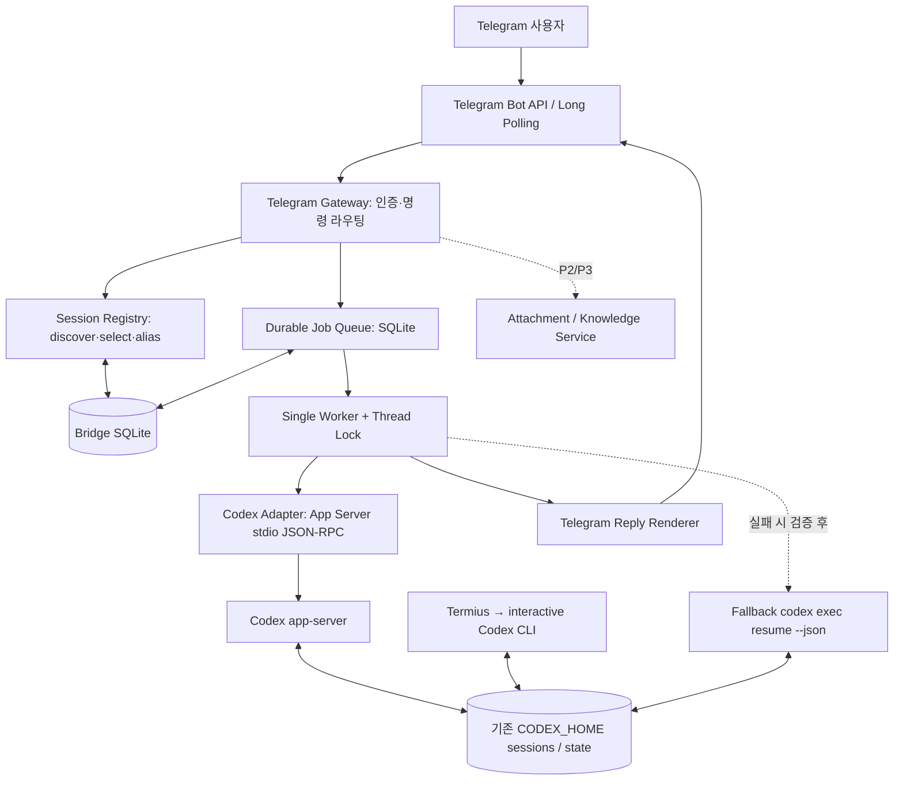

# Heimdall: Telegram ↔ Codex CLI 세션 공유 브리지

> **문서 종류:** Codex 구현 지시서 + 상세 기술 설계서 (Implementation-Ready Spec)  
> **버전:** 1.0 / **기준일:** 2026-10-14 (Asia/Seoul)  
> **프로젝트:** `heimdall`  
> **systemd 서비스:** `heimdall-bridge.service`  
> **Telegram 봇 표시 이름:** `Heimdall`  
> **우선순위:** 기존 Codex CLI 세션 공유(A안) > 안정적인 Telegram 대화 > 개인 지식 비서 기능의 단계적 확장  
> **대상 하드웨어:** Raspberry Pi 4 Model B, RAM 4GB, 64비트 Raspberry Pi OS Lite 기반 Linux (실제 OS는 현장에서 확인)  
> **작성 의도:** 이 파일 하나만 Codex CLI에 전달해도 구현을 시작하고, 각 단계에서 안전하게 검증할 수 있어야 한다.

---

## 0. Codex에게 내리는 최상위 작업 지시

너는 기존 Raspberry Pi `haaland-agent` 환경에 **신규 독립 프로젝트 `heimdall`**를 구현하는 시니어 Python/Linux 엔지니어다.

**필수 수행 원칙**

1. **기존 `Kakao-Radar`는 절대로 변경하지 않는다.** 해당 프로젝트의 코드, 봇 토큰, systemd 서비스, 환경 파일, SQLite DB, 배포 방식, 텔레그램 업데이트 소비자를 건드리지 않는다. 필요 시 이름과 구조를 *읽기 전용으로만* 확인한다.
2. 기존 `haaland-agent`와 Codex CLI의 인증·세션 기록은 **그대로 재사용**하되, `~/.codex` 내 파일을 직접 편집하지 않는다.
3. 처음에는 **읽기 전용 진단**부터 한다. 설치 버전과 App Server RPC 호환성, 계정, `CODEX_HOME`, 세션 발견 여부를 보고한다.
4. App Server 프로토콜은 지속적으로 바뀔 수 있다. 이 문서의 JSON은 참조 예시이며, **실제 장비의 `codex app-server generate-json-schema` 출력과 공식 문서가 최종 기준**이다. 미지원 필드를 임의로 전송하지 않는다.
5. 구현은 P0(MVP) → P1(복구·승인·운영) → P2(멀티미디어) → P3(장기 지식 DB/RAG)로 나눈다. **한꺼번에 광범위한 변경을 하지 않는다.** 단계별 테스트·검증·결과 보고를 남긴다.
6. 사용자에게 묻지 않아도 되는 기술적 세부는 합리적으로 정하되, 토큰 생성·대외 공개·위험 권한 확대·기존 서비스 수정 같은 행위는 임의로 실행하지 않는다.
7. **Telegram에서 임의의 셸 명령을 직접 실행하는 기능을 만들지 않는다.** `/select`, `/database` 등은 브리지 명령이고, 일반 텍스트만 Codex의 대화 입력으로 전달한다. Codex의 실행 권한도 샌드박스/승인 정책으로 제한한다.
8. `danger-full-access`, `--yolo`, 승인 자동 수락, 토큰 출력, 기존 `.codex` 폴더 삭제, 기존 Kakao-Radar 서비스 재시작/변경은 금지한다.
9. 네트워크 장애/프로세스 종료 시 **중복 실행보다 보수적인 복구**를 선택한다. 실행 여부가 애매하면 `uncertain`으로 표시하고 사람이 확인하도록 한다.
10. 모든 구현은 재부팅·재연결·정전·중복 메시지·외부 CLI 동시 접근·잘못된 UUID를 고려한다.
11. 운영 중 발생한 문제를 다른 독립 서비스에 전파하지 않는다. 로그·리소스·설정·종료/재시작 경로를 분리한다.
12. 최종적으로 실제 Pi에서 검증한 사실과 아직 미검증인 기능을 분리해 보고한다.

### 최초 실행 순서 (Codex용)

- [ ] `pwd`, `whoami`, `id`, `uname -a`, `free -h`, `df -h`, Python/Codex 버전 확인.
- [ ] `which codex`, `codex --version`, `codex login status`, `codex app-server --help`, `echo "${CODEX_HOME:-$HOME/.codex}"` 확인. **비밀 내용은 출력하지 말 것.**
- [ ] 실행 중인 Kakao-Radar 서비스/경로를 식별하고 변경 금지 범위를 문서화. 기존 봇 토큰을 읽거나 출력하지 말 것.
- [ ] Codex 세션 백업 방법을 점검하되 실제 백업은 사용자 승인·저장 용량 확인 후 수행.
- [ ] App Server 스키마 생성과 `initialize`/`thread/list` 스모크 테스트. 세션을 단순 조회할 때는 `thread/read`를 이용해 불필요한 로딩 회피.
- [ ] 새 저장소와 Python 패키지 골격 생성, 테스트 작성, P0 구현.
- [ ] P0 테스트가 끝날 때까지 실제 Telegram Bot 토큰이 없으면 `FakeTelegramTransport`로 통합 테스트하고 토큰 누락을 정확히 보고.

---

## 1. 프로젝트 목표 / 성공 정의

### 1.1 한 문장 목표

외부 스마트폰의 **Telegram 봇 `Heimdall`**에서 집 Raspberry Pi에 설치된 **기존 Codex CLI의 대화 세션(Thread)** 을 보고 선택하고 이어서 질문하면, 동일한 실제 Codex 세션에 질문이 추가되고 답변이 Telegram에 반환되는 시스템.

### 1.2 실제 사용자 흐름

```text
사용자(스마트폰 Telegram)
    /database
      ↓
기존 Termius/CLI에서 생성된 Codex 세션도 조회
      ↓
    /select 019a1234      ← 유일한 접두사라면 허용
      ↓
    "지난번에 하던 Python 작업 계속하자"
      ↓
Telegram Bridge → 선택된 Codex Thread에 turn/start
      ↓
Codex가 기존 문맥을 이어받아 작업/답변
      ↓
Telegram 메시지(진행 상황 → 최종 답변)
      ↓
나중에 Termius에서 동일 Thread 재개 가능
```

### 1.3 주요 요구 사항 (MUST)

- **A안 채택:** 기존 Linux CLI 세션과 Telegram이 Codex의 **실제 thread ID**를 공유.
- `/database`, `/select <ID>`, `/new <이름>`, `/current`, `/help`, `/status`, `/queue`, `/cancel` 제공.
- 선택된 세션에 **일반 텍스트를 재작성하지 않고 그대로** 전달. 불필요한 시스템 프롬프트 삽입 금지.
- 진행 상황은 사용자에게 알리되 최종 답변은 Codex의 정식 최종 메시지에 근거.
- Telegram Bridge는 재시작 후에도 선택 세션과 큐 상태 유지.
- 기존 Kakao-Radar 미변경.
- 기본적으로 단일 개인 사용자/개인 채팅만 허용.
- API 과금 없는 **기존 Codex CLI 인증 사용을 우선**. 인증 방식, 플랜 정책과 사용량 제한은 해당 설치/계정 기준으로 검증하며 무료/무제한이라고 주장하지 말 것.
- 라즈베리파이 로컬 저장소를 기본으로 사용.

### 1.4 하지 않는 것 (P0 제외)

- Kakao-Radar 변경/병합.
- 무제한 장기 기억 제공을 약속하는 기능. **Codex session ≠ 영구 RAG 지식 DB**.
- 복잡한 프론트엔드, 웹 관리자 페이지, 공개 포트, 원격 SSH 직접 제공.
- 사진 OCR/동영상 전사/외부 URL 본문 수집 (단계적 확장).
- 여러 Codex 작업을 병렬로 실행하는 스케줄러.
- 원래 Codex 세션 기록 파일의 직접 수정 또는 삭제.
- Telegram 사용자에게 일반적인 원격 셸 명령 실행 권한 제공.

---

## 2. 네이밍 및 분리 정책 (확정)

| 영역 | 확정 이름/값 |
|---|---|
| Project | `heimdall` |
| Python package | `heimdall_bridge` |
| Systemd service | `heimdall-bridge.service` |
| Telegram display name | `Heimdall` |
| Telegram bot username | 아직 정하지 않음. BotFather에서 별도 등록하고 실제 사용 가능 여부 확인 필요 (`...bot` 형태) |
| 로컬 프로젝트 경로 | `~/heimdall/` 권장; 실제 홈/파일시스템 확인 후 결정 |
| 앱 상태 저장 경로 | 프로젝트 외부 영속 디렉터리 권장 (`~/.local/share/heimdall/`) |
| 환경 변수 파일 | `~/.config/heimdall/bridge.env` 권장, 권한 0600 |
| Codex thread 저장 | 기존 `CODEX_HOME` (기본 `$HOME/.codex`), **수정 금지** |
| 기존 프로젝트 | Kakao-Radar, haaland-agent 유지 |

> `[중요]` Linux 사용자가 다르면 기존 세션이나 인증 정보가 보이지 않을 수 있다. 서비스 `User`, `HOME`, `CODEX_HOME`, PATH, 로그인 상태가 반드시 동일한 실행 환경을 참조해야 한다. 단, 기존 인증을 읽을 수 있다는 이유만으로 임의의 비밀 파일 내용을 출력하거나 이동시키지 말 것.

---

## 3. 시스템 아키텍처



### 3.1 각 컴포넌트 역할

1. **Telegram Gateway**: 봇 업데이트 long polling, 사용자·채팅 화이트리스트, slash command 라우팅, 입력 검증, Telegram API rate limit 처리.
2. **Session Registry**: App Server `thread/list`/`thread/read` 활용, 별칭·허용경로·목록 페이징, UUID 앞부분을 전체 ID로 안전하게 해석, 활성 세션 저장.
3. **Durable Job Queue**: Telegram message → immutable job 기록, 중복 처리 방지, 순서·상태·에러 관리.
4. **Turn Dispatcher**: 단일 글로벌 worker, 세션별 순서 보장, 외부 CLI와 충돌 검증, `thread/resume` → `turn/start` 수행.
5. **Codex Adapter**: App Server 프로세스 제어, JSONL/JSON-RPC 프레이밍, 요청 ID 매핑, server-initiated approval request 처리, 재연결·타임아웃.
6. **Reply Renderer**: 진행 상태 메시지, delta 누적, 완성 항목 처리, 긴 메시지 분할, 실패 사유 표시.
7. **Health/Operations**: systemd 시작·정지·재기동, 로그, 백업, 테스트, 설정 검증.

### 3.2 핵심 원칙

- **Codex가 세션 대화의 Source of Truth**. Bridge SQLite는 세션 캐시/태그/선택/큐/승인 상태의 Source of Truth.
- 브리지는 AI 모델이 아님. 요청·응답의 통로이면서 안전장치를 담당.
- 브리지는 `.codex/sessions` JSONL을 직접 편집하지 않음. 파일 파싱은 최후의 읽기 전용 호환성 우회이자 별도 어댑터로 격리.
- Codex CLI/App Server 기능은 버전 의존. 런타임 진단에서 지원 기능 목록을 생성하고 `unsupported`를 명시할 것.
- **A안에서 완전히 실시간으로 하나의 프로세스를 공유하는 게 아니라, 같은 영속 thread 기록을 다시 여는 것**임. CLI가 동시에 같은 thread를 수정하는 충돌은 별도 제어 필요.

---

## 4. Codex App Server 연결 스펙

### 4.1 선택 이유

- 공식 인터페이스가 `thread/list`, `thread/read`, `thread/resume`, `thread/start`, `thread/fork`, `turn/start`, `turn/interrupt`, `item/*`, 승인 요청을 지원.
- JSON-RPC 스타일, 기본 stdio로 통신 가능. 공개 소켓 불필요.
- 비대화형 `exec resume`보다 **리스트·승인·이벤트 스트리밍** 구현이 자연스럽다.
- **주의:** App Server는 아직 변화할 수 있는/실험적인 기능들이 있고, 설치 버전의 실제 schema가 우선.

**공식 참조:**
- https://developers.openai.com/codex/app-server
- https://developers.openai.com/blog/codex-as-a-platform
- https://core.telegram.org/bots/api

### 4.2 프로토콜/프로세스

- Python이 `asyncio.create_subprocess_exec("codex", "app-server", ...)` 형태로 실행. **shell=True 금지**.
- `stdout`: 줄마다 JSON 메시지. `stderr`: 진단 로그로 취급하며 비밀값 제거.
- 프로세스 1개를 기본으로 유지. 죽으면 재시작 및 initialize handshake.
- 각 요청은 고유 정수 `id`, pending futures로 correlation. 알 수 없는 이벤트 타입은 에러로 종료하지 말고 경고/계수/샘플링 로그.
- `initialize` 요청 성공 후 `initialized` 알림을 보내야 함. 동작 순서와 필요 필드는 생성 스키마를 우선.
- 앱 ID: `clientInfo.name = "heimdall"`, `title = "Heimdall"`, `version`은 실제 패키지 버전.

**초기화 예시 (개념):**

```json
{"id":1,"method":"initialize","params":{"clientInfo":{"name":"heimdall","title":"Heimdall","version":"0.1.0"}}}
{"method":"initialized","params":{}}
```

> 경고: 위 두 줄은 **첫 번째 응답을 받은 뒤 다음 알림을 보내는 순서**의 의미다. 실제 구현에서는 첫 번째 요청에 대한 성공 응답을 기다린 후 `initialized` 전송.

### 4.3 세션 발견: `/database`

`thread/list`는 페이지네이션, 정렬, 출처 필터를 지원하며, 출처를 비우면 `cli`, `vscode` 등 인터랙티브 세션 위주만 반환될 수 있음. 따라서 `cli`, `vscode`, `exec`, `appServer`를 명시적으로 포함해 조회하자(사용자의 직접 CLI 세션 및 Telegram 세션 포함). 서브에이전트 세션은 기본 목록에서 숨기되 필요시 옵션으로 노출.

```json
{
  "id": 20,
  "method": "thread/list",
  "params": {
    "limit": 50,
    "sortKey": "updated_at",
    "sortDirection": "desc",
    "sourceKinds": ["cli", "vscode", "exec", "appServer"],
    "archived": false
  }
}
```

- 응답의 `data[]`에서 전체 `id`, `name` 또는 `preview`, `cwd`(있는 경우), `createdAt`, `updatedAt`, `status` 취득.
- `nextCursor`가 있으면 `/database <page>`에서 추가 조회. **전체 목록을 매번 무조건 다 읽는 구현 금지**. 조회 예산/캐시 TTL(예: 30초) 사용.
- 정렬은 최근 사용 순; 사용 시 `updated_at`과 `recency_at` 의미를 확인하고 실제 결과를 검증.
- 목록에 존재해도 현재 사용자에게 허용되지 않은 경로의 세션은 노출 금지 또는 선택 불가 표시.
- 표시 시 민감 정보가 섞일 수 있는 `preview`는 제한된 글자 수만 표시하고, private allowed-user 전용.
- 현재 선택된 세션에는 `● selected`; 활성 실행 세션은 `◉ running` 등 표시.
- 세션이 열리지 않거나 삭제되었으면 `unavailable` 표시하고 자동 대체 선택 금지.

**출력 예시:**

```text
🛡 Heimdall · Codex Threads

● 1) Haaland Agent
   019a1234... · ~/haaland-agent
   마지막 사용: 2026-10-14 20:35

  2) 개인 지식 메모
   019a2345... · ~/notes
   마지막 사용: 2026-10-13 22:10

사용: /select 019a1234
다음: /database 2
```

> UUID 앞 8자리 문자열은 **실제 thread id가 아니라 예시값**. 실제 Codex의 thread ID 형식/길이를 하드코딩하지 말고 서버가 반환한 원문 문자열을 보존할 것. 접두어 매칭만 제공.

### 4.4 세션 선택: `/select <ID>`

1. `ID`가 전체 thread ID이면 정확히 매칭.
2. 짧은 prefix이면 현재 접근 가능한 세션들에서 고유 매칭 확인.
3. 0건이면 not found, 2건 이상이면 ambiguous 오류(원하는 ID 재입력 안내).
4. `thread/read`로 실제 상태 및 `cwd` 검증 (대화를 메모리에 불러오지 않음).
5. 허용 경로, 외부 실행 상태, 세션 삭제 여부 검사.
6. `chat_bindings`의 `active_thread_id` 원자적으로 저장.
7. 선택만으로 `turn/start`하지 않음. 기존 queued job의 `thread_id`도 바꾸지 않음.
8. 사용자에게 세션명, 전체/짧은 ID, cwd(민감 부분 마스킹), 상태 응답.

### 4.5 새 세션: `/new <별칭>`

- 생성 시 허용된 작업 디렉터리로 고정; 불명확하면 사전 설정된 `DEFAULT_CWD` 사용.
- `thread/start` RPC를 호출, 결과의 `thread.id` 저장.
- `name` 필드가 생성 시 무시되거나 누락될 수 있으므로 Bridge 별칭 저장을 우선. Codex의 사용자 지정 thread name API가 지원되면 추가로 동기화.
- 성공 후 해당 chat_id의 active thread로 설정.
- **임의의 Git 저장소를 선택하도록 사용자 입력을 경로에 삽입하는 기능 P0 제외**.

### 4.6 기존 세션 재개 및 질문

- `thread/read`는 조회, `thread/resume`은 메모리 로드/구독, `turn/start`는 실제 수행.
- 읽기 전용 조회를 위한 `/database`, `/select`, `/history`는 resume을 남발하지 않음.

```json
{"id":30,"method":"thread/resume","params":{"threadId":"<FULL_THREAD_ID>","excludeTurns":true}}
{"id":31,"method":"turn/start","params":{"threadId":"<FULL_THREAD_ID>","input":[{"type":"text","text":"지난번에 하던 작업을 이어서 해줘"}]}}
```

**파싱 규칙:**

- 첫 RPC 성공 후 후속 RPC 수행. `turn/start` 결과의 `turn.id`를 즉시 `jobs.codex_turn_id`에 기록.
- `item/agentMessage/delta`: 해당 turn/item의 **미완성 화면 표시용**.
- `item/completed` 중 `agentMessage` (특히 `phase=final_answer` 또는 해당 버전의 공식 최종 메시지 규칙)를 권위 있는 완성 답변으로 집계. 여러 메시지 item이 나오면 순서/phase를 보존하되 reasoning·raw tool output을 혼합하지 않음.
- `turn/completed`에서 `turn.status`가 `completed`일 때만 정상 완료. `failed`, `interrupted` 등은 각각 실패·취소 상태 처리.
- `item/started`/`item/completed`는 command/file/tool 활동 표시만 하되 민감 stdout 원문은 기본적으로 Telegram에 재전송하지 않음.
- 응답의 완전성 검증을 위해 일부러 `item/agentMessage/delta`를 모두 쌓아 최종 본문이라고 가정하지 말 것.
- `thread/turns/list` 또는 `thread/items/list` 지원 여부를 확인해 장애 후 답변 재구성에 활용.

### 4.7 중단과 승인

- `/cancel`은 해당 채팅 사용자의 현재 실행 job에 연결된 `threadId`/`turnId`를 사용하여 `turn/interrupt` 실행.
- 실제 작업 종료 이벤트를 기다린 뒤 `cancelled`; 단순 API 응답만으로 프로세스 전체가 안전하게 멈췄다고 과장하지 말 것.
- `item/commandExecution/requestApproval`, `item/fileChange/requestApproval` 등 App Server의 **server-initiated request**가 발생할 수 있음.
- 승인 요청을 받은 뒤, 선택된 Telegram 사용자에게 **명령/변경 범위, cwd, 위험, 유효시간**을 보여주고 `승인(이번만)`/`거부` 제공. **자동 승인 절대 금지.**
- 답변은 `threadId`+`turnId`+RPC request ID+Telegram user id+nonce/토큰을 묶어 검증. 오래된 버튼 재사용 차단.
- P0에 승인 UI가 없으면 **기본 readOnly로 수행**하며 추가 승인이 필요한 요청은 fail closed(거부 후 사용자에게 안내). **무기한 매달린 승인 요청 금지**.
- App Server `thread/shellCommand`는 샌드박스 밖에서 실행될 수 있으므로 브리지에서 **노출/사용 금지**.

### 4.8 폴백: `codex exec resume --json`

App Server가 설치되지 않았거나 이 기기의 프로토콜이 호환되지 않으면 별도 fallback adapter를 허용한다. 단, 실행 전에 설치 버전의 실제 CLI `codex exec --help`, `codex exec resume --help`를 확인한다.

```bash
# 명령 형식의 예시. 실제 사용 전 지원 옵션 확인.
codex exec --json resume '<FULL_THREAD_ID>' '질문 내용'
```

- **shell string 조립 금지.** 반드시 `asyncio.create_subprocess_exec`에 인자 배열로 전달. stdin(`-`) 지원 여부를 확인하면 사용자 입력은 stdin으로 전달.
- 기존 CLI 세션을 fallback이 성공적으로 재개할 수 있는지는 실제 장비에서 검증해야 함.
- 폴백은 동시 사용, 승인, 타임아웃, 스트리밍 면에서 App Server보다 제약이 있음. 실패 시 무한 재시도 금지.
- App Server와 exec가 동시에 같은 thread를 쓰지 않도록 공유 스케줄러/락과 별도 adapter 단일 선택 정책 유지.

---

## 5. Telegram UX 및 명령어 계약

### 5.1 명령어 목록 및 우선순위

| Command | 사용자 동작 | 상세 계약 | 단계 |
|---|---|---|---|
| `/start` | 최초 안내 | 보안 인증 이후 사용 방법 안내 | P0 |
| `/help` | 전체 명령어 | 명령어, 예시, 제한 사항 | P0 |
| `/database [페이지 또는 검색어]` | 세션 리스트 | 기존 CLI + Telegram 생성 세션, 최근순, 페이지네이션 | P0 |
| `/select <full-id/prefix>` | 세션 선택 | 선택만 하고 프롬프트 실행하지 않음 | P0 |
| `/current` | 선택 정보 | 세션/작업경로/실행 상태/큐 | P0 |
| `/new [별칭]` | 새 세션 | 기본 워크스페이스에서 생성 후 선택 | P0 |
| `/status` | 런타임 진단 | App Server/worker/queue/버전/연결 | P0 |
| `/queue` | 대기 작업 | 해당 사용자의 queue 길이·상태 | P0 |
| `/cancel` | 작업 취소 | running이면 interrupt; queued면 DB 취소 | P0 |
| `/rename <별칭>` | 세션 별칭 | Bridge 별칭 우선, Codex title 동기화는 가능할 때만 | P1 |
| `/history [N]` | 최근 대화 | turn list/read, 기본 10개 | P1 |
| `/fork [별칭]` | 현재 스레드 분기 | `thread/fork`, 새 id로 선택 | P1 |
| `/approve ...`, `/deny ...` 또는 inline buttons | 승인 | 현재 작업에 한정, 만료·한 번만 | P1 |
| `/search <검색어>` | 전 세션/KB 검색 | 전체 원문 인덱스는 P3에서 별도 구현 | P3 |

**일반 메시지:** `/`로 시작하는 Telegram 명령어가 아닌 텍스트는 선택된 thread에 **프롬프트 그대로** enqueue. 세션 미선택이면 `/database` 또는 `/new` 안내만 보내고 실행하지 않음.

**예약어 충돌:** Telegram에서 `/database@BotUsername` 형태를 받을 수 있으므로 봇 명령 파서에서 해당 Bot의 username을 안전하게 처리. 잘못된 slash 명령은 Codex로 보내지 말고 도움말 표시.

### 5.2 UX 예시

```text
사용자: /database
봇:   [1] Haaland Agent       019a1234…  Last: 20:35
      [2] Personal Notes      019a5678…  Last: Yesterday
      /select <ID> 로 연결하세요.

사용자: /select 019a1234
봇:   ✅ 연결: Haaland Agent / ~/haaland-agent

사용자: 지난번에 만든 코드의 오류를 정리해줘
봇:   ⏳ Codex 실행 중 · 작업 #51
봇:   ✅ Codex 답변 ... (정식 최종 텍스트)

사용자: /current
봇:   선택 세션: Haaland Agent / 상태: idle
```

### 5.3 텔레그램 결과 표시/길이 제약

- Bot API text 메시지 일반 제한: 4,096자. **서식 파싱과 Unicode를 고려해 안전하게 약 3,500자 이하로 단락별 분할**.
- 긴 메시지는 텍스트가 잘리지 않도록 순서를 보존하고 `(1/N)` 접두사 추가. 코드블록 분할 시 Markdown 파서 실패를 방지하기 위해 처음에는 `parse_mode=None`(plain text) 기본.
- 최종 원문 의미를 바꾸지 않으면서 Telegram 크기 제한 대응. 필요하면 장문 전체를 `.txt`로 별도 전달하는 기능을 P1에.
- 진행 알림은 단일 메시지에 편집(`editMessageText`)으로 표시하고 너무 빈번하게 갱신하지 않음(예: 1~2초 이상 throttle, 429 backoff).
- 사용자에게 내부 추론이나 시스템 프롬프트, 토큰, 환경 변수, 승인 보안 토큰을 출력하지 말 것.
- 완료 전에 "완료"라고 쓰지 않음. 중간 상황은 "실행 중", 실패는 명확한 실패 사유.

---

## 6. Bridge 영속 데이터 모델 (SQLite)

### 6.1 설계 규칙

- **기존 Codex thread id를 원문 그대로 저장**. UUID 형식이라고 가정하고 변환하거나 재발급하지 말 것. 접두사 매칭은 UI 기능.
- `sessions`는 로컬 캐시이고, 세션 실제 대화 기록은 Codex가 관리.
- Telegram 입력을 수신하는 순간 **작업 대상 thread_id를 확정**. 사용자가 이후 `/select`해도 기존 job 대상은 변하지 않음.
- 시간은 DB에서 UTC ISO8601, Telegram 출력은 `Asia/Seoul`.
- 테이블 migration, WAL, `busy_timeout`, FK, 적절한 index.
- 모든 텍스트 입력은 parameterized SQL, 사용자 값 문자열 결합 금지.

### 6.2 초기 마이그레이션 DDL (구현 가능 기초안)

```sql
PRAGMA foreign_keys = ON;
PRAGMA journal_mode = WAL;
PRAGMA busy_timeout = 5000;

CREATE TABLE IF NOT EXISTS schema_migrations (
  version INTEGER PRIMARY KEY,
  applied_at TEXT NOT NULL
);

CREATE TABLE IF NOT EXISTS sessions (
  thread_id TEXT PRIMARY KEY,
  alias TEXT,
  codex_name TEXT,
  preview TEXT,
  cwd TEXT,
  source_kind TEXT,
  status TEXT NOT NULL DEFAULT 'unknown',
  codex_created_at INTEGER,
  codex_updated_at INTEGER,
  last_seen_at TEXT NOT NULL,
  unavailable_reason TEXT
);

CREATE TABLE IF NOT EXISTS chat_bindings (
  chat_id INTEGER PRIMARY KEY,
  user_id INTEGER NOT NULL,
  active_thread_id TEXT,
  selected_at TEXT,
  FOREIGN KEY (active_thread_id) REFERENCES sessions(thread_id)
    ON UPDATE CASCADE ON DELETE SET NULL
);

CREATE TABLE IF NOT EXISTS jobs (
  job_id INTEGER PRIMARY KEY AUTOINCREMENT,
  chat_id INTEGER NOT NULL,
  user_id INTEGER NOT NULL,
  telegram_message_id INTEGER NOT NULL,
  thread_id TEXT NOT NULL,
  input_kind TEXT NOT NULL DEFAULT 'text',
  prompt TEXT NOT NULL,
  state TEXT NOT NULL DEFAULT 'queued' CHECK (
    state IN ('queued','dispatching','running','completed',
              'failed','cancelled','uncertain')
  ),
  request_id TEXT,
  codex_turn_id TEXT,
  response_text TEXT,
  error_code TEXT,
  error_summary TEXT,
  attempt_count INTEGER NOT NULL DEFAULT 0,
  created_at TEXT NOT NULL,
  started_at TEXT,
  finished_at TEXT,
  heartbeat_at TEXT,
  FOREIGN KEY (thread_id) REFERENCES sessions(thread_id),
  UNIQUE(chat_id, telegram_message_id)
);

CREATE INDEX IF NOT EXISTS idx_jobs_state_order
  ON jobs(state, created_at, job_id);
CREATE INDEX IF NOT EXISTS idx_jobs_thread_order
  ON jobs(thread_id, job_id);

CREATE TABLE IF NOT EXISTS job_events (
  event_id INTEGER PRIMARY KEY AUTOINCREMENT,
  job_id INTEGER NOT NULL,
  event_type TEXT NOT NULL,
  detail_json TEXT,
  created_at TEXT NOT NULL,
  FOREIGN KEY (job_id) REFERENCES jobs(job_id) ON DELETE CASCADE
);
CREATE INDEX IF NOT EXISTS idx_job_events_job
  ON job_events(job_id, event_id);

CREATE TABLE IF NOT EXISTS approvals (
  approval_id INTEGER PRIMARY KEY AUTOINCREMENT,
  job_id INTEGER NOT NULL,
  thread_id TEXT NOT NULL,
  turn_id TEXT NOT NULL,
  rpc_request_id TEXT NOT NULL,
  type TEXT NOT NULL,
  preview TEXT,
  state TEXT NOT NULL CHECK (
    state IN ('pending','approved','denied','expired','resolved')
  ),
  callback_nonce_hash TEXT NOT NULL,
  created_at TEXT NOT NULL,
  expires_at TEXT NOT NULL,
  decided_at TEXT,
  FOREIGN KEY (job_id) REFERENCES jobs(job_id) ON DELETE CASCADE,
  UNIQUE(thread_id, turn_id, rpc_request_id)
);

CREATE TABLE IF NOT EXISTS telegram_updates (
  update_id INTEGER PRIMARY KEY,
  received_at TEXT NOT NULL,
  handled_at TEXT
);
```

**구현 메모:** 같은 `chat_id,message_id`에 사진·캡션·문서 묶음이 있을 경우 P2에서 별도 `job_attachments` 테이블을 추가. Telegram media group은 서로 다른 메시지 ID가 있을 수 있으므로 P2에서 그룹핑 정책 정의. `telegram_updates`와 `jobs` 유니크 제약을 **함께** 사용해 중복 업데이트와 중복 명령 모두 방어. `/database`, `/select` 같은 비-job 명령도 update idempotency를 고려할 것.

### 6.3 상태 머신

```text
queued ───────────────┐
  │                   └─> cancelled  (아직 실행 전)
  ↓
dispatching ──RPC OK──> running ──turn completed──> completed
  │                       │
  │                       ├──turn failed───────> failed
  │                       ├──interrupt ack/event→ cancelled
  │                       └──연결 끊김/재시작──> uncertain
  └──요청 수락 여부 불명확────> uncertain
```

- `dispatching`은 "Codex로 전달 시도 중"이며 요청이 도착했는지 애매한 상태를 별도 관리.
- Worker restart에서 `queued`만 안전하게 자동 다시 처리. `dispatching`/`running`은 thread history와 turn id, timestamp 대조 후 결과 판정.
- 증거가 충분하지 않으면 `uncertain`으로 남기고 **자동 재실행 금지**.
- `cancelled`는 실제 작업 중지 확인 여부를 기록. 이미 파일 변경이 있었다면 작업 취소가 되돌리기를 의미하지 않음.

---

## 7. 실행 큐, 동시성, CLI 충돌

### 7.1 MVP의 실행 정책

- Raspberry Pi 4GB 고려: **글로벌 Codex 실행 Worker 1개**.
- 모든 job은 `created_at, job_id` 순 FIFO; 동일 thread는 절대 동시 실행 금지.
- 여러 Telegram 메시지를 연속 전송하면 각각 독립된 턴으로 순서대로 실행.
- 큐 길이 한도를 설정(예: 30건). 상한 초과 시 신규 요청 거부 및 안내. 무제한 메모리/디스크 소모 방지.
- 승인 대기 중인 Codex turn이 글로벌 worker를 붙잡고 있을 수 있으므로 명확한 timeout 및 취소 정책 필요.
- `MAX_JOB_RUNTIME`, `APPROVAL_TIMEOUT`, `MAX_QUEUE_LENGTH`, `POLL_INTERVAL`은 설정파일로 조절.

### 7.2 시작/종료 규칙

```python
async def on_telegram_prompt(update):
    ensure_authorized_private_chat(update)
    binding = db.get_binding(update.chat_id)
    if not binding or not binding.active_thread_id:
        return reply("먼저 /database 와 /select 또는 /new 를 사용하세요.")
    # 요청을 받는 순간 thread ID를 고정한다.
    job = db.insert_job_idempotent(
        chat_id=update.chat_id,
        user_id=update.user_id,
        telegram_message_id=update.message_id,
        thread_id=binding.active_thread_id,
        prompt=update.text,
        state="queued",
    )
    return reply(f"📥 작업 #{job.job_id} 대기 등록")

async def worker_loop():
    while service_running:
        job = db.claim_next_queued_atomically()
        if not job:
            await sleep_small()
            continue
        if not await codex_adapter.preflight(job.thread_id):
            db.transition(job, "uncertain", reason="External activity suspected")
            continue
        await execute_one_turn(job)  # resume → start → events → final
```

이 코드는 개념용 의사코드이며 실제 구현에서는 **DB 트랜잭션, crash recovery, timeout, shutdown cancellation, subprocess cleanup, typed errors**가 반드시 포함되어야 한다.

### 7.3 Termius / 외부 Codex CLI 동시 접근 **한계**

이 프로젝트의 최대 설계 리스크.

- Bridge 자체의 worker/SQLite 락은 **Bridge로 들어온 요청만** 보호한다.
- 사용자가 Termius에서 별도로 `codex resume <same-id>`를 실행하면 **외부 프로세스가 동일한 thread를 동시에 사용할 수 있다**.
- App Server가 반환하는 `thread.status`는 해당 App Server의 로드 상태를 설명하는 것이므로 **동일 호스트의 모든 외부 CLI 프로세스에 대한 완벽한 글로벌 락이라고 가정하면 안 된다**.
- 프로세스 목록/롤아웃 타임스탬프로 외부 실행을 추정할 수 있으나 오탐·미탐 가능. **완전한 동기화 보장으로 표현 금지**.

**안전한 운영 제안:**

1. P0: 같은 thread를 Termius/Telegram에서 **동시에 쓰지 말 것**이라고 명시. 실행 전 상태/기록 변경 검사, 변화 감지 시 enqueue 보류 또는 거절.
2. P1: 사용자용 래퍼 명령 `heimdall-codex resume <id>`를 제공해 **CLI와 Bridge 모두 같은 OS advisory lock(`flock`)을 협조적으로 획득**하도록 구현. 기존 CLI 자체 호출을 강제할 수 없다는 제한을 문서화.
3. P1: 가능하면 Codex App Server 한 프로세스를 여러 인터페이스가 공동 이용하는 구조를 연구하되, 무인증 공개 WebSocket으로 전환 금지.
4. 충돌 감지 시 사용자의 명시적 재시도 요청 전에는 작업을 재개하지 않음.

---

## 8. 보안 정책

### 8.1 사용자/채팅 인증

- Telegram `from_user.id` **정수형 whitelist**, 개인 chat `type == private`만 허용. `username` 인증 사용 금지(변경 가능).
- chat_id와 user_id가 설정된 유일한 소유자여야 함. Forwarded message, 익명 사용자, group/channel 접근 차단.
- 미승인 사용자의 `/start`에도 세션명·서버 정보·파일경로 노출하지 말 것.
- Telegram API 토큰은 `EnvironmentFile`/비밀 디렉터리에만, chmod 0600, 로그 출력 금지. 저장소에 `.env` 업로드 금지.
- 자격 증명과 Telegram 세션이 탈취된 경우 위협 모델에 포함.

### 8.2 Codex 실행 권한

- P0: 기본 **readOnly sandbox** 사용. 실제 App Server 스키마에서 맞는 `sandboxPolicy`/`approvalPolicy` 값을 확인한 뒤 적용.
- P1: 특정 allowed project workspace에 한정된 `workspaceWrite` + 실행 승인 흐름을 구현할 수 있음.
- **`dangerFullAccess` 금지**, 승인 자동 수락 금지.
- Telegram에서 보낸 콘텐츠(웹페이지, 파일, 프롬프트)도 외부 입력이므로 프롬프트 인젝션 가능성 전제.
- `ALLOWED_WORKSPACES`에 포함된 canonical realpath 아래만 작업. 상대 경로, `..`, symlink 탈출, bind-mount 등의 경로 우회 검증 필요.
- 기존 같은 Linux 유저를 쓰는 경우 OS 권한으로 `.codex` 등 사용자 파일 접근 가능성이 있으므로 **Codex sandbox 자체의 보호를 검증**하고, 프롬프트만으로 비밀 파일을 읽어오도록 하지 말 것.
- 웹 연결이나 외부 전송, 파괴적 명령은 별도 승인. 세션 history에 있는 과거 지시가 현재 보안 정책을 우회하지 못하도록 함.

### 8.3 승인 워크플로우 (P1)

- 사용자가 승인해야 하는 명령, 파일 변경, 네트워크 접근 범위를 구체적으로 표시.
- 기본 `거부`, 시간 만료 시 거부, 작업 완료 후 자동 만료.
- Callback의 `user_id`, `chat_id`, `job_id`, `thread_id`, `turn_id`, `request_id`, nonce 일치 검증. 한번 사용하면 무효.
- 요청이 해결된 뒤 같은 Telegram 버튼으로 재승인 불가능.
- 확실하게 구분되지 않는 승인 결정 유형은 **거부**.
- 승인 거부 후 사용자에게 사유 및 계속 가능한 안전한 대안 표시.

### 8.4 로그 정책

- 토큰, 인증 헤더, 원문 환경 변수, `.codex/auth.json`, 개인 민감 파일 내용은 로깅 금지.
- 로그 기본 필드: `event_time`, `request_id`, `job_id`, `thread_id_prefix`, `state`, `latency_ms`, `error_code`.
- 프롬프트 본문은 DB 큐의 복구 목적상 암호화 없는 로컬 저장일 수 있으므로 파일 권한 제한, retention/삭제 정책 필요. 운영 로그에는 원문 중복 저장하지 않음.
- 추후 지식 비서에 보안 민감 업무 자료가 들어갈 수 있으므로 **Telegram/외부 AI 반출의 회사 보안 규정 준수** 확인.

---

## 9. 파일·사진·URL·영상 확장 설계 (P2)

사용자 원래 비전은 Telegram에서 **텍스트, 그림, 동영상, 하이퍼링크 등** 자료를 보내고 나중에 AI가 활용하는 것.

P0에서는 일반 텍스트를 Codex에 직접 전달한다. P2에서는 **선택된 session으로 자료를 전달**하는 기능을 추가한다.

| 입력 유형 | P2 동작 | Codex로 전달 |
|---|---|---|
| 일반 텍스트 | 그대로 enqueue | text |
| URL | 원문 그대로 전달, 나중에 안전한 fetch 옵션 | text |
| 사진 | Bot API로 다운로드, 파일 검증, 로컬 임시 저장 | `localImage` (버전 지원 확인) |
| PDF/DOC/ZIP | 저장 후 형식/용량 제한, 안전 경로 | 설명+첨부 경로 또는 별도 처리 |
| 동영상 | 로컬 보관, 크기 제한, 미지원 안내 | 원본 즉시 직접 입력 보장 안 됨. 추후 프레임/자막/음성 전사 |
| 음성 | 로컬 보관 후 별도 전사 | 텍스트 변환 후 Codex 입력(추후) |

- Telegram 일반 Bot API `getFile` 다운로드 제한은 **20MB**. 큰 영상은 **Local Bot API Server**를 별도로 고려해야 하며, 먼저 현재 공식 한도를 검증.
- Telegram `file_id`는 다운로드 식별자이지 원본 백업 자체가 아니다. 로컬 원본 저장과 SHA-256, MIME/크기 확인 필요.
- 파일 경로는 봇이 생성한 안전한 이름을 사용하고 사용자가 보낸 filename은 메타데이터로만 보관. 폴더 탈출 방지.
- 업로드 파일 악성 콘텐츠/압축폭탄/너무 큰 디스크 사용/무한 미디어 그룹 대비 최대 크기·확장자·개수·총량 제한.
- 자동 URL 스크래핑 기능을 만들면 **SSRF 방지**: loopback, 사설 IP, link-local, metadata 주소, DNS rebinding 및 redirect 검사. P0는 URL fetch 금지.
- 사진 원본을 Codex Session에 보여주는 것과 영구 Knowledge DB에 저장하는 것을 구분.

---

## 10. 장기 Knowledge 비서 확장 (P3)

장기적으로는 Telegram ↔ Codex 세션 브리지와 별도의 **Knowledge Hub** 결합이 목표.

### 10.1 정보 저장 계층 분리

- **Session Store (기존 Codex)**: 코딩·질문·대화 문맥, turn history, compaction. 무제한/영구 정확 기억 보장 X.
- **Knowledge Store (신규 로컬)**: 원본 사진·영상·텍스트·URL, metadata, 검색 인덱스, 태그, 추출 내용.
- **Reasoning (Codex)**: 검색된 자료를 근거로 대답하고 출처 ID를 표시.

### 10.2 Knowledge DB 후보

- `items`: 자료 ID, 타입, 제목, 설명, 생성/입력 시각, soft-delete.
- `assets`: 파일 경로, 원래 이름, SHA-256, MIME, 크기, 다운로드 상태.
- `contents`: 본문/캡션/OCR/전사/URL 추출 텍스트, 추출기 버전.
- `tags`, `item_tags`: 다대다 분류.
- `sources`: Telegram chat_id/message_id/media_group_id 또는 URL, 수집 시각.
- `processing_jobs`: OCR, 웹페이지 본문 추출, 음성 전사 등 비동기 작업.
- `search`: SQLite FTS5. 한국어 2글자 검색 한계를 고려해 `unicode61`+`trigram` 또는 별도 normalizer/LIKE 보완.
- 미래 임베딩/벡터 검색은 부착 가능한 별도 서비스로, 초기부터 무거운 모델을 Pi 4GB에 상주시키지 않는다.

### 10.3 AI 동작 정의

- `/search <keyword>`: 원문 검색, 여러 자료 ID를 반환.
- `/ask <natural language question>`: 근거 검색 → 컨텍스트 구성 → Codex 답변. 답변마다 근거 `HK-...` 명시.
- 검색 자료가 없으면 "기록에서 찾지 못했다"고 응답. 근거 없는 단정 금지.
- 운영 시스템의 `/database`는 **Codex Thread 목록**, 미래 `/search`는 **지식 자료 검색**이므로 서로 다른 개념.

---

## 11. 예상 폴더 구조

```text
~/heimdall/
├── README.md
├── SPEC.md                  # 본 명세 복사본
├── pyproject.toml
├── .gitignore
├── .env.example             # 실제 토큰 없음
├── config.example.toml
├── src/
│   └── heimdall_bridge/
│       ├── __init__.py
│       ├── __main__.py
│       ├── config.py
│       ├── logging_setup.py
│       ├── bot/
│       │   ├── application.py
│       │   ├── auth.py
│       │   ├── commands.py
│       │   ├── messages.py
│       │   └── rendering.py
│       ├── codex/
│       │   ├── interface.py
│       │   ├── app_server.py
│       │   ├── exec_fallback.py
│       │   ├── protocol.py
│       │   └── session_registry.py
│       ├── queue/
│       │   ├── dispatcher.py
│       │   ├── worker.py
│       │   ├── recovery.py
│       │   └── locks.py
│       ├── db/
│       │   ├── connection.py
│       │   ├── repository.py
│       │   └── migrations/
│       │       └── 0001_initial.sql
│       └── security/
│           ├── workspace_policy.py
│           └── approvals.py
├── scripts/
│   ├── diagnose.sh
│   ├── install_service.sh
│   ├── backup.sh
│   └── smoke_appserver.py
├── schemas/                 # 설치 Codex 버전에서 생성 (용량/버전 관리 확인)
├── deploy/
│   └── heimdall-bridge.service.template
├── tests/
│   ├── unit/
│   ├── integration/
│   └── fixtures/
└── docs/
    ├── OPERATIONS.md
    ├── DECISIONS.md
    └── TROUBLESHOOTING.md

# 영속 데이터(저장소 외부)
~/.local/share/heimdall/
├── bridge.sqlite3
├── media/                    # P2
└── backups/

# 비밀 설정(저장소 외부)
~/.config/heimdall/bridge.env
```

**P0의 라이브러리 제안:** Python 3.11+ 가능 여부 확인; `python-telegram-bot`, `aiosqlite` 또는 작은 SQLite repository, `pydantic`/`pydantic-settings` 선택, `pytest`, `pytest-asyncio`, `ruff`. 설치 호환성은 ARM64/Pi OS에서 검증. 가상환경 `.venv` 분리.

---

## 12. 설정 설계

### 12.1 `.env.example` (실제 값 절대 커밋 금지)

```dotenv
# Telegram BotFather에서 새로 발급한 전용 토큰
TELEGRAM_BOT_TOKEN=__SET_ME__
TELEGRAM_ALLOWED_USER_IDS=__SET_NUMERIC_ID__

# Codex CLI와 동일 Linux 환경
CODEX_BIN=codex
CODEX_HOME=__ABSOLUTE_PATH_TO_EXISTING_CODEX_HOME__

# 절대 경로. 설치 스크립트에서 현재 시스템 기준으로 생성
HEIMDALL_DATA_DIR=__ABSOLUTE_DATA_DIR__
HEIMDALL_DEFAULT_CWD=__ABSOLUTE_PROJECT_WORKSPACE__
HEIMDALL_ALLOWED_WORKSPACES=__COMMA_SEPARATED_ABSOLUTE_PATHS__

HEIMDALL_MAX_CONCURRENT_TURNS=1
HEIMDALL_MAX_QUEUE_LENGTH=30
HEIMDALL_DEFAULT_PERMISSION_MODE=readonly
HEIMDALL_LOG_LEVEL=INFO
```

### 12.2 설정 검증

- env 파일 없음/토큰 없음/whitelist 없음/허용 경로 없음: **fail closed** 후 로그로 설정 오류만 출력. 임시로 모두 허용하는 폴백 금지.
- `CODEX_HOME` 존재, 해당 사용자 접근 권한, 쓰기 대상 및 저장소 여유 공간 검사.
- `ALLOWED_WORKSPACES`: 절대 경로만, `Path.resolve()` 후 검증. 루트 `/` 전체 허용 기본값 금지.
- 어떤 프롬프트도 `CODEX_BIN`이나 systemd 명령줄을 변경하지 못함.

---

## 13. systemd 서비스 설계

`deploy/heimdall-bridge.service.template` 예시 (실제 절대 경로를 installer에서 치환):

```ini
[Unit]
Description=Heimdall Telegram to Codex Bridge
Wants=network-online.target
After=network-online.target

[Service]
Type=simple
User=__LINUX_USER__
Group=__LINUX_GROUP__
WorkingDirectory=__ABSOLUTE_PROJECT_DIR__
Environment=HOME=__ABSOLUTE_HOME_DIR__
Environment=PYTHONUNBUFFERED=1
EnvironmentFile=__ABSOLUTE_CONFIG_PATH__/bridge.env
ExecStart=__ABSOLUTE_PROJECT_DIR__/.venv/bin/python -m heimdall_bridge
Restart=on-failure
RestartSec=5
TimeoutStopSec=30
NoNewPrivileges=true
UMask=0077

[Install]
WantedBy=multi-user.target
```

**주의:** `ProtectHome=true`, `PrivateUsers=`, `DynamicUser=` 등을 무작정 넣으면 `CODEX_HOME`에 접근하지 못하거나 파일을 저장하지 못할 수 있다. 추후 hardening은 실제 Codex 사용 요구 사항과 테스트 결과를 근거로 적용. 같은 유저가 기존 Codex 세션을 사용하는 조건과 충돌하는 보호 설정은 피할 것.

### 13.1 설치/운영 명령 (참고)

```bash
# 서비스 파일을 생성·검증한 뒤에만 사용 (서비스 실제 설치는 사용자 승인 절차에 따름)
systemd-analyze verify ./deploy/heimdall-bridge.service
sudo systemctl daemon-reload
sudo systemctl enable --now heimdall-bridge.service
systemctl status heimdall-bridge.service
journalctl -u heimdall-bridge.service -n 100 --no-pager
```

**주의:** 위 명령이 아직 실제 실행되었다는 뜻은 아니다. Codex는 실제 설치 전에 사용자 확인과 안전한 서비스 구성을 검사할 것.

### 13.2 Kakao-Radar 격리 점검

- 별도 systemd unit 이름, 별도 토큰, 별도 Python venv, 별도 `WorkingDirectory`, 별도 DB/로그 경로.
- Telegram Bot API long polling은 **봇 토큰당 하나의 업데이트 소비자**만 허용하는 것으로 설계. 새 봇을 생성해 충돌 방지.
- 기존 Kakao-Radar의 config나 polling 프로세스를 수정하지 않음.
- Pi 메모리 부족 시 swap/OOM/재시작 정책 진단하되 기존 서비스를 임의로 종료하지 않음.

---

## 14. 장애 복구 / 운영

### 14.1 실패 유형과 대응

| 상황 | 기본 동작 |
|---|---|
| Telegram 업데이트 중복 | `update_id`, `(chat_id, message_id)`로 idempotent 처리 |
| Bot API 429 | retry_after 기준 backoff + jitter |
| Bot 토큰 없음/무효 | fail closed, 사용자에게 민감값 비노출 |
| Codex App Server 시작 실패 | 재시도 제한, health degraded, fallback 가능 여부 진단 |
| `initialize` 실패 | 버전/스키마 확인, 임의 메시지 송신 금지 |
| `thread/list` 실패 | 오류 출력, 마지막 캐시는 'stale' 명시 |
| 세션 식별 불일치 | 무조건 선택 거절, 추정 선택 금지 |
| 기존 세션 삭제/이동 | unavailable, 자동 신규 세션으로 변경 금지 |
| turn 실행 중 연결 끊김 | `uncertain`, 이력 대조, 자동 재실행 금지 |
| 앱 재시작 | `queued`만 다시 시작 가능, 이전 `running`은 reconciliation |
| 타임아웃 | 먼저 interrupt, 종료 증거 확인, 불확실하면 uncertain |
| CLI 외부 동시 작업 감지 | 실행 보류/거절 및 설명 |
| DB 손상 | 서비스 중단, 백업 무결성 확인, 수동 복원 |
| 디스크 거의 가득 참 | 신규 첨부/작업 거부, 기존 데이터 보존 |
| Telegram 메시지 분할 실패 | 본문 보존, 재전송 중복 방지, 파일 대체 전달 검토 |

### 14.2 백업

- 사용자 승인 후 DB SQLite online backup API나 적절한 snapshot 절차 적용. WAL 사용 시 **DB 파일만 무작정 복사**하면 불일치 위험.
- Codex sessions는 기존 관리 정책 존중. P1 백업은 원본을 변경하지 않는 일관성 있는 스냅샷으로 구현, 백업 전 디스크 용량 검사.
- 모든 파일 경로는 실제 존재 확인 후 사용, 덮어쓰기 방지.
- 정기 백업 및 복구 테스트는 P1.

### 14.3 관측성

`/status` 출력에는 다음 제공:

```text
Heimdall v0.1.0
Telegram: connected
Codex: app-server ready (version: ...)
Active thread: ...
Queue: waiting 2 / running 1 / uncertain 0
Permissions: read-only
Disk: available ...
Kakao-Radar: independent (not managed here)
```

실제 API 값을 확인하지 못했으면 `unknown`으로 표시. 암묵적으로 healthy 처리 금지.

---

## 15. 테스트 계획 (단위·통합·E2E)

### 15.1 단위 테스트

- [ ] `UUID exact` / unique prefix / ambiguous prefix / prefix not found.
- [ ] `/database` 페이지네이션·정렬·종료 커서·빈 목록.
- [ ] 허용 사용자 / 허용하지 않은 사용자 / group / channel 거부.
- [ ] message id 중복 및 update id 중복.
- [ ] `/select B` 후에도 이미 큐에 있던 질문은 A에서 실행.
- [ ] 두 연속 메시지 작업 순서 FIFO.
- [ ] 4,096자 제한 근처의 한국어/영어/코드블록 답변 분할.
- [ ] App Server stdout 이벤트 순서 바뀜/중복/알 수 없는 이벤트 처리.
- [ ] `item/agentMessage/delta`와 `item/completed` 중복 합치지 않음.
- [ ] `turn/completed.status=failed`를 성공으로 표기하지 않음.
- [ ] read-only 권한 및 path canonicalization.
- [ ] 승인 callback nonce/replay/timeout/다른 사용자 클릭 차단.
- [ ] `queued → running → completed/failed/cancelled/uncertain` 전이 검증.
- [ ] 앱 재시작 시 dispatching 작업이 자동 중복 실행되지 않음.

### 15.2 통합 테스트 (Fake Codex Adapter)

- [ ] Telegram의 일반 text가 한 번만 Codex adapter에 전달된다.
- [ ] Bot 설정/토큰 없이 fake transport에서 P0 시나리오 재현.
- [ ] 요청 ID와 응답 ID 매칭, 다수 이벤트와 최종 메시지 집계.
- [ ] Codex adapter subprocess 강제 종료 후 복구 및 상태 표시.
- [ ] Telegram 429, 타임아웃, 응답/수정 실패에도 job 상태 유지.
- [ ] 운영 DB migration이 여러 번 적용되어도 안전(idempotent).

### 15.3 실제 장비 스모크 테스트 (저위험 순서)

1. **읽기 전용 진단:** 서비스 사용 계정과 `CODEX_HOME` 확인.
2. **세션 발견:** 기존 Termius Codex 세션이 App Server `thread/list`에 나타나는지 실제 ID와 비교.
3. **읽기 조회:** `thread/read`로 기존 세션 metadata, status 확인(대화 수정 X).
4. **테스트 새 세션:** 쓰기 권한 없는 빈 테스트 디렉터리에서 `thread/start`.
5. **첫 질문:** 간단한 텍스트 turn, 최종 응답 수신 확인.
6. **재개:** Codex CLI에서 새 테스트 thread를 열어 Telegram 쪽 추가 대화가 보이는지 확인.
7. **역방향:** CLI에서 테스트 thread에 대화 추가 후 Telegram `/select`와 새 turn으로 이어받는지 확인. **동시 실행 금지**.
8. **시퀀스:** 질문 2건 연속 전송 후 순차 처리, 순서 확인.
9. **복구:** 처리 도중 브리지 종료 → state reconciliation → 중복 실행 없는지 확인.
10. **격리:** Kakao-Radar의 기존 서비스 및 봇이 그대로 동작하는지 별도 점검. 기존 환경 변경 없음 확인.

### 15.4 P0 합격 조건 (Definition of Done)

- [ ] 기존 CLI 세션 중 적어도 1개가 `/database`에 정상 표시.
- [ ] `/select <ID>` 성공, 이후 일반 텍스트를 해당 thread에 전달.
- [ ] Telegram에서 Codex 정식 답변 수신, 긴 답변도 유실 없음.
- [ ] 같은 세션을 Termius에서 다시 이어받을 수 있음을 검증(동시 실행 아닌 순차 사용).
- [ ] `/new`, `/current`, `/queue`, `/status`, `/help`, `/cancel` 기본 동작.
- [ ] 허용되지 않은 Telegram 사용자에게 모든 데이터/API 접근 차단.
- [ ] Kakao-Radar 파일·서비스·DB·토큰 미수정 증명.
- [ ] 재부팅/재시작 후 `chat_bindings`와 작업 큐가 복구.
- [ ] 애매한 작업은 중복 실행되지 않고 `uncertain`으로 안전하게 남음.
- [ ] README와 OPERATIONS에 실제 명령, 사용 방법, 제한 사항 기록.

---

## 16. 단계별 구현 백로그 (Codex 실행 계획)

### Phase 0: 환경 점검/스키마 확보 (필수)

- [ ] 진단 스크립트 `scripts/diagnose.sh` 작성 및 실행. 비밀값 출력 금지.
- [ ] 설치된 Codex App Server 명령 지원 확인.
- [ ] `codex app-server generate-json-schema --out ./schemas` 실행 가능 여부 확인.
- [ ] JSON-RPC 연결 최소 예제 `scripts/smoke_appserver.py` 작성.
- [ ] 기존 CLI 세션 하나 이상 조회. 결과에 ID 원문을 그대로 보존.
- [ ] App Server가 미지원이면 `exec resume` fallback 검증과 기술적 차이 기록.
- [ ] 보호 대상 Kakao-Radar 경로와 서비스명 기록(읽기 전용).

**Deliverable:** `docs/ENVIRONMENT_REPORT.md`, 생성된 스키마, 읽기 전용 smoke 결과.

### Phase 1: MVP 브리지 (P0)

- [ ] Python package, config, logs, migration.
- [ ] Telegram auth + `/start`, `/help`.
- [ ] App Server `initialize`, `thread/list`, `thread/read`.
- [ ] `/database`, `/select`, `/current`, `/new`.
- [ ] 텍스트 job enqueue, 단일 worker, `thread/resume`/`turn/start`.
- [ ] `item/completed`/`turn/completed` 집계, Telegram 최종 답변.
- [ ] `/queue`, `/cancel`, `/status`.
- [ ] unit/integration tests and documentation.

**Deliverable:** 기존 CLI와 세션을 공유하는 검증된 로컬 Telegram Bot MVP.

### Phase 2: 견고한 운영 (P1)

- [ ] RPC 재연결 및 app-server 종료/재생성.
- [ ] job reconciliation, uncertain 처리.
- [ ] Telegram 승인 UI + 요청 만료/거부 기본값.
- [ ] 안전한 쓰기 모드(workspace allowlist).
- [ ] 세션 rename/history/fork.
- [ ] termius 협조 락 래퍼 제공(선택).
- [ ] systemd 배포, 백업/복구 테스트, 리소스/로그 관리.

**Deliverable:** 실제 개인 운영이 가능한 회복력 있는 서비스.

### Phase 3: 첨부·자료 저장 (P2)

- [ ] 이미지/문서 수신, 안전 다운로드, 저장/해시.
- [ ] Codex localImage 입력 경로 검증.
- [ ] 동영상/음성 저장 및 미지원 안내, 추후 추출 파이프라인.
- [ ] URL 수집 기능은 SSRF 대비 후 선택적 제공.

### Phase 4: 개인 Knowledge 비서 (P3)

- [ ] SQLite `items/assets/contents/tags/sources/jobs`.
- [ ] 텍스트/캡션/문서 본문 FTS5 검색.
- [ ] OCR, 음성 전사, 영상 프레임 추출.
- [ ] `/search`, `/ask` 또는 Codex 도구 연동.
- [ ] 검색 결과 자료 ID 인용, 환각 방지, 복구 가능 백업.

---

## 17. 결정 기록 (ADR)

### ADR-001: 프로젝트 분리
- **결정:** Kakao-Radar 변경 없이 `heimdall` 신규 독립 실행.
- **이유:** 기존 자동화 서비스의 안정성·복원력 유지.

### ADR-002: 기존 세션 공유(A안)
- **결정:** 별도 Telegram 전용 대화 저장이 아니라 Codex 실제 thread id를 공유.
- **이유:** Termius ↔ Telegram 양방향 맥락 연속성.
- **한계:** 서로 다른 프런트엔드의 실시간 동시 쓰기 충돌은 완전 제어하지 못함.

### ADR-003: App Server 우선
- **결정:** `codex app-server` stdio 우선, `codex exec resume --json`은 검증된 예외 상황 폴백.
- **이유:** 공식 thread/turn API, 이벤트, 중단, 승인 요청 지원.
- **한계:** 버전별 API 변경과 실험적 기능을 감안하여 설치 스키마 기준.

### ADR-004: 로컬 SQLite 영속 큐
- **결정:** 단일 worker/SQLite.
- **이유:** Pi 4GB에서 단순성, 장애 복원력, 재부팅 보존.

### ADR-005: 최소 권한
- **결정:** 기본 read-only, 승인 없는 권한 확대 불가.
- **이유:** 인터넷 경유 Telegram에서 로컬 Codex를 원격 제어하는 보안 위험.

### ADR-006: 세션과 지식 DB 분리
- **결정:** Codex session은 대화 상태, Knowledge DB는 장기 자료 저장.
- **이유:** 대화 compaction, 용량과 검색 정확성 한계.

### ADR-007: 이름
- **결정:** Project `heimdall`, systemd `heimdall-bridge.service`, Telegram 표시 이름 `Heimdall`.

---

## 18. 아직 현장에서 확인해야 할 사항

1. 정확한 설치 Codex 버전, App Server가 현재 계정/아키텍처에서 동작하는지.
2. `CODEX_HOME`, 실제 세션 경로·상태 DB, Termius에서 사용하는 Linux 사용자와 PATH.
3. 실제 Codex CLI에서 만든 세션의 thread ID가 App Server 목록에 어떻게 표시되는지.
4. App Server와 CLI를 같은 세션에 **순차적으로** 재개했을 때 기록 일관성이 유지되는지.
5. `thread/start`/`turn/start`의 읽기 전용 sandbox 설정이 장비의 설치 버전에서 어떻게 표현되는지.
6. Telegram 봇 신규 token과 username, 소유자 Telegram numeric user ID.
7. Pi의 가용 저장 용량, microSD/SSD 경로, 기존 서비스 RAM 사용량.
8. 외부 CLI 작업 충돌을 감지할 수 있는 신뢰성 있는 지표가 있는지.
9. App Server 지원이 부족할 경우 fallback 체계를 실제로 사용할지.
10. 사용자가 처음 허용할 워크스페이스 목록과 나중에 추가할 쓰기 모드 범위.

> 위 정보는 *아직 확인된 사실이 아니다.* Codex는 추정치를 실제 결과처럼 쓰지 말고 환경 점검에서 확인한 근거를 남겨야 한다.

---

## 19. 최종 인계 프롬프트 (Codex CLI에 복사할 텍스트)

```text
이 저장소의 SPEC.md를 처음부터 끝까지 읽고 Heimdall를 구현해줘.

우선 Phase 0(읽기 전용 환경 점검 + 실제 설치 Codex App Server 프로토콜 검증)부터 시작해.
기존 Kakao-Radar/haaland-agent는 손대지 마. 기존 CODEX_HOME 대화 기록을 읽을 수는 있지만 직접 수정하지 마.
명세서와 실제 장비의 Codex CLI 버전/생성 스키마가 충돌하면 실제 공식 스키마와 실행 결과를 기준으로 설계를 조정하고 docs/DECISIONS.md에 이유를 기록해.

Phase 0 확인 후 Phase 1(MVP)을 구현해. 인증 토큰이 없으면 fake Telegram transport로 테스트를 진행하고 토큰을 요구하는 설정만 남겨둬. Telegram에서 모든 문구를 Codex로 전달하되, slash commands는 bridge에서만 처리해.

특히 /database에 기존 Termius CLI 세션이 나타나고 /select로 고른 세션에 질문이 추가되며, 그 내용을 나중에 Termius에서 순차적으로 이어받을 수 있는지가 핵심 합격 기준이야.

SQLite durable queue, idempotency, state reconciliation, fail-closed security를 구현해. danger-full-access나 무인 승인, 토큰 로그 출력, 외부 공개 포트는 절대 만들지 마.

각 Phase 완료마다 수정 파일, 테스트 결과, 실제 Codex 연동 여부, 미검증 항목, 남은 리스크를 요약 보고해. 자신 없는 API는 임의로 만들어 쓰지 말고 현재 설치 버전에서 검증해.
```

---

## 20. 공식 기술 문서 / 참고 자료

- [Codex App Server 공식 문서](https://developers.openai.com/codex/app-server): thread, turn, 이벤트, 승인, JSON-RPC, 스키마 생성
- [Codex as a platform](https://developers.openai.com/blog/codex-as-a-platform): `exec`/SDK/App Server 선택 가이드
- [Codex Sign in with ChatGPT / App Server](https://developers.openai.com/siwc/token-sharing-open-source/codex-app-server): 별도 OAuth 토큰 전달 시나리오. **본 프로젝트는 우선 기존 로컬 Codex 로그인을 그대로 사용**하며, 별도 토큰 공유 플로우를 임의 도입하지 않는다.
- [Telegram Bot API](https://core.telegram.org/bots/api): 업데이트·메시지·파일·편집 API
- [Telegram Bot FAQ](https://core.telegram.org/bots/faq): 파일 다운로드 제한, rate limit
- [SQLite FTS5](https://www.sqlite.org/fts5.html): 향후 지식 DB 검색

**문서 유지보수 원칙:** 이 설계는 목표와 안전 조건의 기준이고, App Server JSON 필드와 Codex 실행 옵션의 세부는 장비에 설치된 Codex 버전의 공식 스키마·CLI help를 우선한다. 변경은 `docs/DECISIONS.md`에 기록한다.

---

**Heimdall v1.0 명세 끝.**
